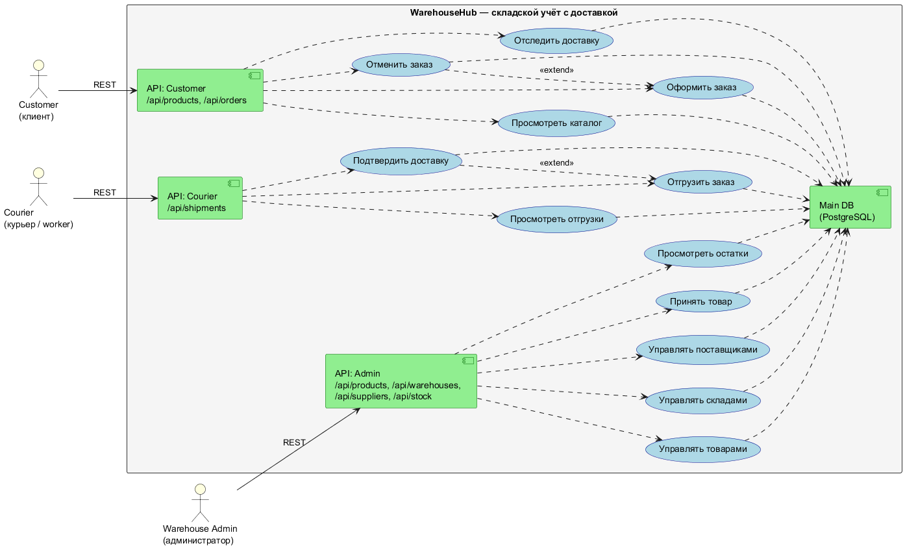

# Проект "Складской учет"
Выполнил: Батаргин Егор Александрович
## Описание
WarehouseHub — монолитное Spring Boot-приложение для складского учёта с доставкой. Система позволяет клиентам заказывать товары, курьерам — отгружать и доставлять заказы, администраторам склада — управлять товарами, складами, поставщиками и остатками.

Цель: автоматизировать полный цикл «заказ → резерв на складе → отгрузка курьером → доставка», с корректным учётом остатков и историей движений товара.

## Роли

`Customer (клиент)` -Покупатель. Он просматривает каталог, оформляет/отменяет заказы, отслеживает доставку

`Courier (курьер / worker)` - сотрудник доставки. Он просматривает назначенные отгрузки, отгружает заказы, подтверждает доставку
`Warehouse Admin (администратор)` - сотрудник склада. Он управляет товарами, складами, поставщиками, принимает товар, смотрит остатки

## UseCase диаграмма

Код UseCase диаграммы находиться в файле `UseCase/UseCaseDiagram.puml`

Изображение схемы ниже:

